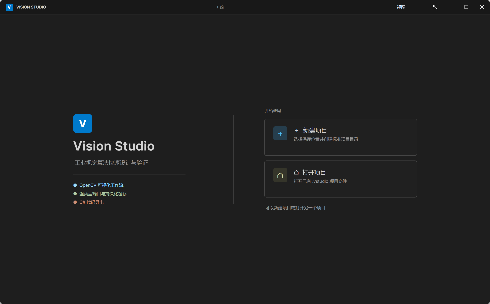
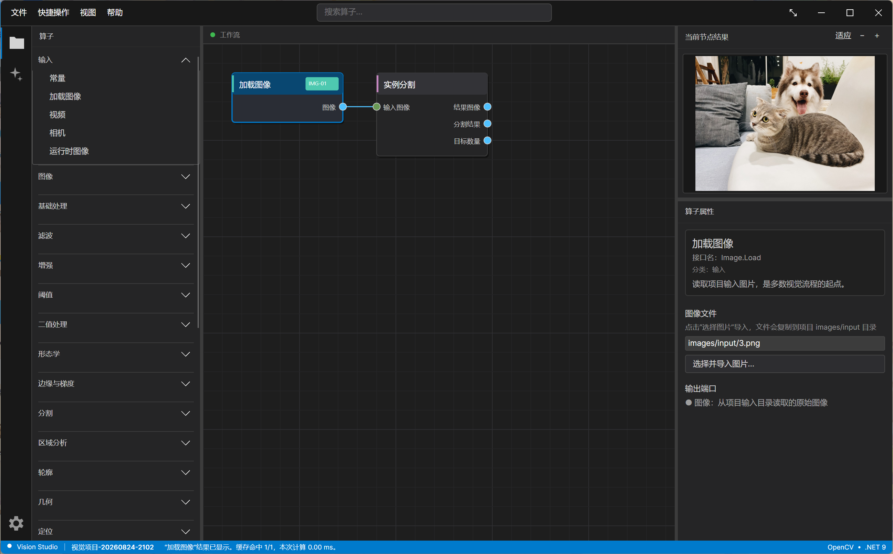

<div align="center">
  
  <h1>Vision Studio</h1>
  <p>面向工业视觉算法设计与验证的可视化 OpenCV 工作流工具</p>
  <p><em>A visual OpenCV workflow studio for industrial vision prototyping.</em></p>

  
  
  
  
  
</div>

Vision Studio 用节点和强类型端口组织图像处理流程。你可以拖拽连接算子、调整参数并即时查看结果，也可以把工作流导出为 C# 源码。项目同时提供 Avalonia 桌面编辑器、响应式 Web 工作台、命令行工具和远程模型驱动的 AI 助手。




## 功能亮点

- 140+ 个算子契约，覆盖图像输入、颜色转换、滤波、增强、阈值、形态学、边缘、轮廓、几何、定位、变换、统计、测量、标定和逻辑等类别。
- 强类型 DAG，支持多输入、多输出、环检测、端口兼容性检查和确定性拓扑执行。
- 点击节点自动执行当前节点及其上游，参数或上游变化时按内容键精确失效缓存；算子在后台线程执行，状态栏显示进度并可随时取消。
- “文件 → 批量运行”可对整个图片文件夹跑同一目标节点，逐张输出测量值并生成 CSV 报告；图片无需放进项目目录。
- 可平移网格画布、圆角正交连线、线路宽命中、自动排版和会话内 `Ctrl+Z` 撤销。
- 图像结果与结构化测量结果统一预览，缓存和输出均保存在项目目录中。
- 中文与英文界面，内置深色、浅色和渐变三种主题。
- 工作流可导出为 C#，也可通过 CLI 和 `IWorkflowAutomationApi` 自动创建、修改和执行。
- 左侧 VS Code 式活动栏可在算子和 AI 助手之间切换；“文件 → 设置”集中管理多个远程 OpenAI 兼容模型，每个模型/项目使用独立上下文。
- 只支持远程模型：AI 助手通过 OpenAI 兼容 API 工作，密钥加密落盘；本地推理运行时与 Provider 插件已移除，也不需要下载任何模型文件。
- 加载图像节点显示 `IMG-01` 短编号；AI 对话支持按编号/节点名指定图片、点击引用或从画布拖入，避免多图流程分析错图。
- AI 助手以自然语言对话为主；需要修改工作流时，回答末尾会附一张“建议改动”卡片，确认后才写入画布。
- Web 版在服务器执行 OpenCV，浏览器只负责编辑、上传和安全预览。

> 部分 AI、高级标定、卡尺和特征节点目前提供稳定接口或基础预览，尚不代表生产级推理或计量精度。准确范围请查看[产品与技术边界](docs/boundaries.md)。

## 运行形态

| 组件 | 用途 | 当前支持 |
| --- | --- | --- |
| `VisionStudio.App` | Avalonia 桌面编辑器 | V2.0 正式发布 Windows x64；Linux 桌面版暂缓发布 |
| `VisionStudio.Runtimes.App` | 直接运行 `.vstudio` 项目、单次/连续检测与结果显示 | Windows x64；随主安装包安装 |
| `VisionStudio.Web` | 响应式 Web 编辑器与服务端执行 API | Ubuntu Server 24.04 x64 |
| `VisionStudio.Cli` | 项目创建、校验、执行和代码导出 | .NET 9 支持的平台 |
| `VisionStudio.Core` | 项目格式、工作流、校验、执行与自动化协议 | UI 无关 |
| `VisionStudio.Operators.OpenCv` | EmguCV/OpenCV 算子实现 | 按目标平台加载原生运行库 |
| `VisionStudio.CodeGen` | C# 工作流代码生成 | UI 无关 |
| `VisionStudio.Ai` / `Ai.Abstractions` | 助手对话、远程 Provider 与受控 Graph Action | 主程序内置，仅远程模型 |

## 技术栈

- .NET 9 / C#
- Avalonia 12
- Emgu CV 4.13 / OpenCV
- ASP.NET Core Minimal API
- xUnit

## 快速开始

### 环境要求

- [.NET SDK 9.0](https://dotnet.microsoft.com/download/dotnet/9.0) 或更高的兼容 SDK
- Windows x64；Web 部署服务器使用 Ubuntu Server 24.04 x64
- Git

克隆并构建：

```bash
git clone <your-repository-url>
cd VisualAlgorithmDemonstration
dotnet restore
dotnet build VisionStudio.sln -c Release
```

### 启动桌面端

```bash
dotnet run --project src/VisionStudio.App
```

应用启动后先新建或打开项目。仓库中的 `samples/DemoProject/DemoProject.vstudio` 可用于查看示例工作流；如需运行示例，请通过“加载图像”节点重新选择一张本地图像。

### 启动项目运行平台

```bash
dotnet run --project src/VisionStudio.Runtimes.App -- samples/DemoProject/DemoProject.vstudio
```

运行平台直接读取 `.vstudio`，复用现有 `WorkflowExecutor`，支持单图片、图片文件夹、视频、EmguCV 相机和模拟输入，以及连续、定时和手动触发。它不执行导出的 C# 脚本。

### 启动 Web 端

PowerShell：

```powershell
$env:VISIONSTUDIO_WEB_TOKEN = "change-this-development-token"
$env:ASPNETCORE_URLS = "http://127.0.0.1:5080"
dotnet run --project src/VisionStudio.Web
```

Bash：

```bash
VISIONSTUDIO_WEB_TOKEN=change-this-development-token \
ASPNETCORE_URLS=http://127.0.0.1:5080 \
dotnet run --project src/VisionStudio.Web
```

打开 `http://127.0.0.1:5080`，输入刚才设置的令牌。生产环境部署、systemd、Nginx 和 Cloudflare Tunnel 建议见 [Web 部署文档](docs/web-deployment.md)。不要将真实令牌提交到仓库。

### 使用 CLI

```bash
dotnet run --project src/VisionStudio.Cli -- new ./demo "Demo"
dotnet run --project src/VisionStudio.Cli -- validate ./demo/workflows/main.vflow
dotnet run --project src/VisionStudio.Cli -- export ./demo/workflows/main.vflow ./demo/generated/Algorithm.cs
```

## 项目格式

```text
ProjectName/
├── ProjectName.vstudio
├── workflows/main.vflow
├── images/
│   ├── input/
│   ├── cache/
│   └── output/
├── output/
├── models/
├── resources/
├── snapshots/
└── .project/
```

`.vstudio` 是项目入口，`.vflow` 保存节点和连接。工作流只保存项目相对路径，输入图像、缓存和输出不会写入工作流 JSON。详细格式和失效规则见[架构设计](docs/architecture.md)。

## 测试

测试按变更影响维度运行，避免每次修改都执行无关平台测试：

```powershell
./scripts/test-changes.ps1 -Dimension Workflow
./scripts/test-changes.ps1 -Dimension Operators,Project
./scripts/test-changes.ps1 -Dimension Ai
./scripts/test-changes.ps1 -Dimension Web
./scripts/test-changes.ps1 -Dimension CodeStyle -NoBuild
```

发布候选版本可运行：

```powershell
./scripts/test-changes.ps1 -Dimension All
```

完整维度和选择规则见[测试规范](docs/testing.md)。

## 构建发布包

```powershell
# Windows 桌面包
./scripts/publish-desktop.ps1 -Platform Windows -Version 2.0.0

# Ubuntu Server Web 包
./scripts/publish-web.ps1 -Version 2.0.0

# Windows 安装程序
./scripts/build-installers.ps1 -Platform Windows -Version 2.0.0
```

所有生成物写入被 Git 忽略的 `artifacts/`。V2.0 正式发布 Windows x64 桌面版和 Ubuntu Server Web，暂不发布 Linux 桌面安装包，也不包含 Android/iOS。Windows 安装包同时包含编辑器、CLI 和项目运行平台；AI 只使用远程接口，不嵌入任何模型或运行时。发布前请阅读[多平台发布说明](docs/platform-release.md)，并自行确认第三方原生运行库和模型的分发许可。

## 文档

- [V2.0.0 更新说明](CHANGELOG.md)
- [V2.0 发布范围与需求追踪矩阵](docs/v2-release-scope-and-traceability.md)
- [V2.0 发布前复核报告](docs/v2-release-readiness-audit.md)
- [项目讲解手册（面向项目介绍与答疑）](docs/project-handbook/00-reading-guide.md)
- [架构设计](docs/architecture.md)
- [开发说明](docs/development.md)
- [产品与技术边界](docs/boundaries.md)
- [AI 工作流自动化 API](docs/ai-workflow-automation-api.md)
- [算子命名与介绍规范](docs/operator-naming-and-description-standard.md)
- [界面规范](docs/ui-style-guide.md)
- [Google 代码风格规范](docs/code-style.md)
- [代码规范审查报告](docs/code-review-report.md)
- [Web 部署](docs/web-deployment.md)
- [测试规范](docs/testing.md)

## 参与贡献

1. Fork 仓库并从主分支创建功能分支。
2. 保持 UI、Core、OpenCV 算子和代码生成的依赖边界。
3. 新增算子时同时补充描述符、执行实现、代码生成和对应测试。
4. 运行与修改相关的测试维度。
5. 提交清晰的 Pull Request，说明行为变化、边界和验证结果。

提交 Issue 时，请包含操作系统、.NET 版本、复现步骤、工作流结构和脱敏后的日志。安全问题或令牌泄露不要公开提交到 Issue。

## 安全提示

- 不要提交 `.env`、访问令牌、证书、模型密钥或包含敏感图片的项目目录。
- Web 版应只通过 HTTPS 暴露；使用 Cloudflare Tunnel 时保持 Kestrel 监听 `127.0.0.1`，无需开放公网 5080。
- 当前 Web 令牌方案面向内部单租户部署，多用户公开服务应额外接入身份认证和项目级授权。

## 许可证

本项目以 [Apache License 2.0](LICENSE) 发布。第三方组件仍分别适用其自身许可证；构建或分发桌面端、Web 端及安装包前，请同时核对 Avalonia、Emgu CV、OpenCV 与各平台原生运行库的许可和再分发要求。
