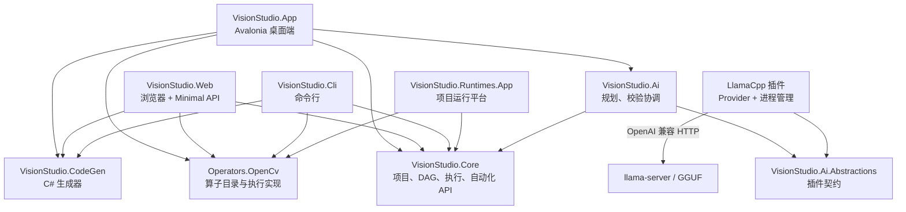
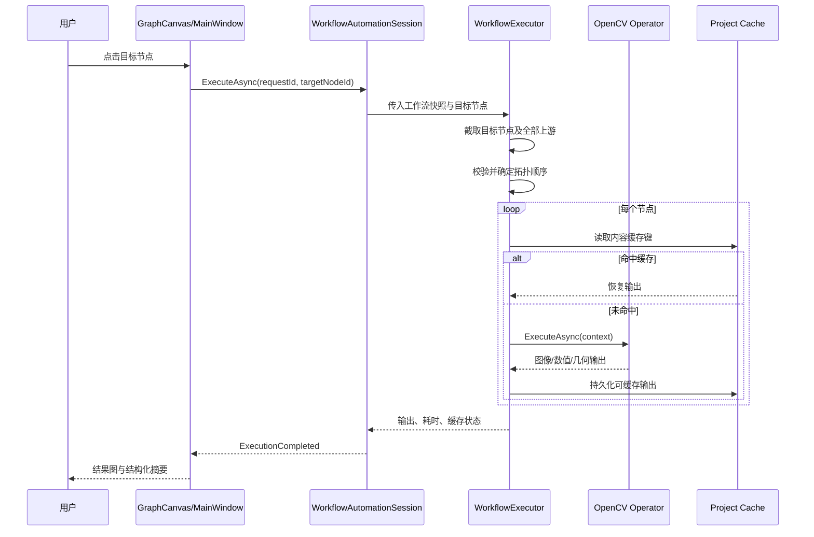

# 总体架构与关键调用链

## 1. 分层原则

项目最重要的架构原则是：工作流核心不依赖 UI，AI 不依赖具体模型，OpenCV 实现不反向依赖桌面端，所有外部修改都经过统一自动化 API。

## 2. 主要工程职责

| 工程 | 职责 | 不应该承担的职责 |
| --- | --- | --- |
| `VisionStudio.Core` | 数据模型、验证、执行、项目、自动化事务 | Avalonia 控件、OpenCV 具体算法、模型调用 |
| `Operators.OpenCv` | 算子描述符、OpenCV 执行、磁盘缓存 | 项目页面、AI 对话、Web 鉴权 |
| `VisionStudio.CodeGen` | 将已验证工作流转为 C# | 执行 UI 逻辑或修改工作流 |
| `VisionStudio.App` | 桌面交互、画布、属性、预览、设置 | 让 AI 直接操作控件或绕过 Core 修改文件 |
| `VisionStudio.Web` | HTTP API、浏览器工作台、服务器项目会话 | 在浏览器执行 EmguCV 原生代码 |
| `VisionStudio.Cli` | 创建、验证、执行和导出入口 | 维护独立工作流语义 |
| `VisionStudio.Runtimes.App` | `.vstudio` 加载、帧源、触发、队列、状态和完整结果显示 | 执行 C# 脚本、复制 WorkflowExecutor、把相机做成普通算子 |
| `Ai.Abstractions` | 稳定的 Provider/插件契约 | 模型专用实现和 UI |
| `VisionStudio.Ai` | 模型配置、插件加载、规划、动作验证 | 捆绑 GGUF 或直接读写画布 |
| `Ai.LlamaCpp` | 启动/连接 llama-server、协议适配 | 进入主程序安装包或修改项目格式 |

## 3. 用户点击节点后的执行链

关键点：执行器不需要知道界面当前显示什么；UI 只选择目标节点并消费执行结果。

## 4. 用户或 AI 修改工作流的调用链

外部修改使用 `WorkflowMutationRequest`，其中包含 `requestId`、`expectedRevision`、编辑列表、描述和可选执行目标。`WorkflowAutomationSession` 在锁内完成以下步骤：

1. 检查请求是否已经处理，保证同一 `requestId` 重试幂等；
2. 比较 `expectedRevision`，防止基于旧图覆盖新修改；
3. 克隆当前工作流，在副本上应用 `AddNode`、`RemoveNode`、`Connect`、`SetParameter` 等编辑；
4. 用真实算子目录进行完整校验；
5. 保存快照、工作流和操作记录；
6. 提升修订号并发布变更事件；
7. 如指定目标节点，则执行新工作流并返回结果。

因此 AI、Web 和将来的脚本集成都共享同一安全边界。

## 5. 数据边界

工作流 JSON 只保存节点、参数、坐标和连接。图像、缓存、输出与资源分别存在项目目录中，并使用项目相对路径；Runtime 的输入源、触发、队列和 `resultMappings` 保存为项目级运行配置。软件级 AI 配置、下载模型和本地运行时不进入项目。

这一区分解决了三个问题：项目可以移动；模型不会被误打进项目包；工作流结构可以参与版本管理，而大体积缓存和图片可以独立管理。

## 6. 架构设计取舍

- 选择强类型 DAG，而不是任意脚本：更容易校验、缓存和可视化，但复杂控制流能力有限。
- 选择进程外 llama-server：模型崩溃与主程序隔离，模型可切换，但首次启动有额外延迟。
- 桌面和 Web 分别实现 UI：能符合各平台交互和安全模型，但前端样式与行为需要双端维护。
- 项目当前使用 JSON：可读、易调试、适合版本管理；超大工作流未来可能需要索引或增量格式。
- 选择 Runtime 外层连续调度，而不是把循环做成普通算子：同一 DAG 可用于编辑预览和逐帧生产运行，但厂商相机、PLC 和上传需要独立适配器。
