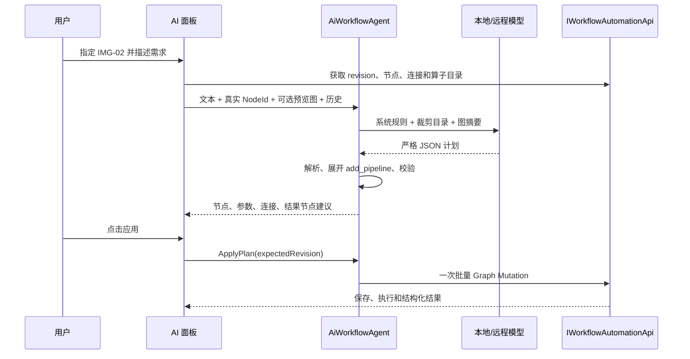

# AI 助手与插件架构

## 1. AI 的准确定位

AI 助手是“工作流规划器”，不是最终检测器，也不是桌面操控机器人。用户描述需求后，模型根据当前图摘要、算子目录和图片引用提出结构化方案；OpenCV 执行方案并产生数字结果。

这种定位能回答一个常见问题：为什么不让模型直接操作 UI？因为鼠标坐标慢、脆弱、难以撤销，也无法可靠验证端口和参数。稳定 API 可以在桌面、Web、测试和未来集成中复用。

## 2. 图片引用

每个 `Image.Load` 节点按工作流顺序获得 `IMG-01`、`IMG-02` 等短编号。用户可以：

- 在文字中写 `[IMG-02]`、图片2或唯一节点名；
- 点击对话框上方的图片标签；
- 把画布节点编号拖进输入框。

解析优先级是明确 IMG 编号、数字描述、唯一名称、当前选中节点。重复的“加载图像”名称不会覆盖明确编号。多图且无法唯一解析时请求会停止并提示指定，避免静默分析错图。

## 3. 规划流程

## 4. 模型能做什么、不能做什么

允许动作只有：增加/删除节点、连接节点、设置参数，以及模型侧紧凑表示 `add_pipeline`。宿主展开后仍是普通编辑动作。

模型不能执行 C#、Shell、URL、文件命令；不能直接写 `.vflow`；不能使用目录外的算子；不能创建重复输入、未知端口或环；不能绕过 revision 冲突；三次修正仍失败时不应用最后一个无效计划。

## 5. 建议模式

当前默认建议模式：模型先返回清晰的节点、接口、参数、连接和结果节点，用户确认后才应用。应用按钮保存的是本次计划和工作流 revision；若用户在等待期间修改了画布，应用会因 revision 冲突而拒绝，防止把旧建议套在新图上。

## 6. 插件分层

主程序只包含：

- `IAiProvider`、`IAiAssistantPlugin` 和模型 Profile 契约；
- 插件清单和 `AssemblyLoadContext` 加载器；
- 通用 OpenAI 兼容 Provider；
- 算子检索、规划、校验、上下文和 UI。

llama.cpp Provider 位于独立插件目录，GGUF、mmproj、llama-server 和 CUDA 文件都不进入主安装包。用户可以只安装软件本体，也可以按需要下载插件和模型。

## 7. 本地、远程与标准模型

| 类型 | 特点 | 配置 |
| --- | --- | --- |
| 本地模型 | 用户已有 GGUF，可离线，硬件由用户承担 | 模型/mmproj 路径、上下文、GPU 层 |
| 远程模型 | 标准 OpenAI 兼容接口，部署灵活 | Base URL、Model ID、API Key、视觉能力 |
| 标准版本地模型 | 软件预置下载定义，用户下载后选择 | URL、文件名、校验与推荐参数 |

软件自动查找已保存路径、环境变量、安装目录 runtime、常用目录与 PATH 中的 llama-server；没有时可以下载安装到 `runtime/llama.cpp`。

## 8. 配置和上下文

配置位于平台的软件级配置目录（Windows 当前用户安装目录的 `config`；Linux 的 `$XDG_CONFIG_HOME/visionstudio`）：

- `config/ai-local-models.json`：本地路径和推理参数；
- `config/ai-remote-models.json`：除内部 ID 外整体加密；
- `config/standard-models.json`：标准模型下载清单；
- `config/ai-contexts.json`：对话历史。

上下文键由“模型 ID + 项目 ID”构成。切换模型不会混用历史，切换项目也不会把客户 A 的图上下文带到客户 B。

## 9. 为什么 AI 仍可能失败

- 小模型可能输出截断或不完整 JSON；
- 输出 Token 上限太小会截断长计划；
- 上下文窗口不足会遗漏算子或图结构；
- 没有 mmproj 时模型无法观察图片；
- 用户没有明确指定多图中的哪一张；
- 算子目录缺少需求所需能力；
- 工作流在建议后被修改，触发 revision 冲突。

系统通过紧凑 `add_pipeline`、最多三次修正、详细错误气泡、可复制原始 JSON和用户确认降低这些风险，但不承诺任意模型都能稳定规划复杂流程。

## 10. 插件安全

模型响应是不可信数据，必须验证；插件 DLL 则是本机代码，安装它等同于信任发布者。正式插件分发需要签名、SHA-256、来源、版本兼容和许可说明。llama-server 默认只监听 `127.0.0.1`，不应该对公网开放。
